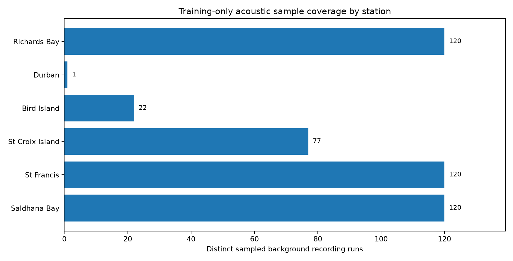
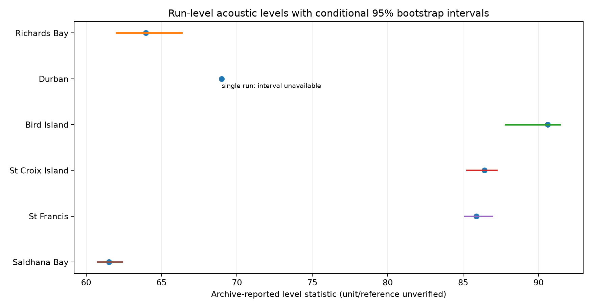
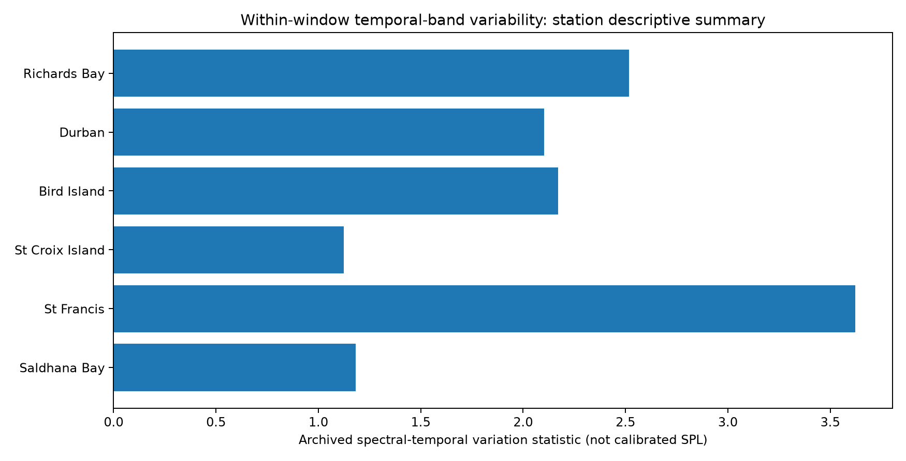
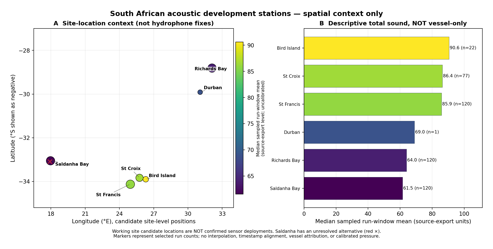
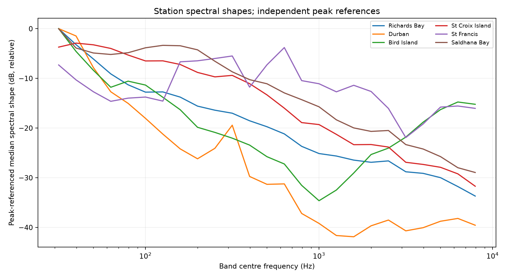
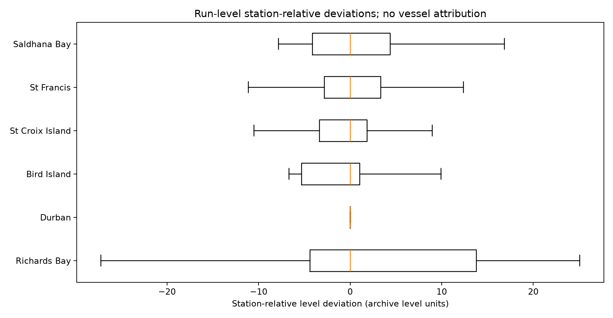

# Descriptive Underwater Acoustic Variability and Limits of Synthetic Vessel-Energy Detection in South African Monitoring Data

**Research Write-Up — French Embassy Underwater Vessel Noise Challenge (Zindi)** | **23 November 2026**

## Abstract

I characterize 460 training-only recording runs across six South African monitoring sites (15-minute windows, 25 third-octave bands from 31.6 Hz to 7.94 kHz) and evaluate synthetic vessel-energy modelling using AIS-associated recordings from VTUAD v1.3.0. Station-level source-export levels, within-window variability, and peak-referenced spectral shapes differ markedly across sites, but lack instrument calibration to dB re 1 µPa and verified natural-vessel ground truth. In a source-disjoint internal synthetic assessment (120 paired scenarios, 840 cases), contrast-varied training reduced added-share RMSE from 0.114236 to 0.094566 and increased ROC AUC from 0.848328 to 0.886421, though the run-bootstrap 95% CI for RMSE improvement crossed zero (−0.00041 to 0.04230) and fixed-0.50 false positives on non-injected controls rose from 0.16667 to 0.30000. Clean-copy verification reproduced the descriptive artifacts, site-context figure, and Experiment 007 decision-gate summaries. This study establishes reproducible diagnostic baselines and explicitly documents why unlocated, uncalibrated total-sound data cannot validate a vessel-pressure map.

**Keywords:** underwater acoustics; domain shift; synthetic mixtures; uncertainty; reproducibility; South Africa.

## 1. Introduction & Contributions

The challenge asks participants to estimate `share_added_vessel` (leaderboard metric `1 − RMSE`) and a diagnostic `score_added_vessel` from 15-minute × 25-band acoustic windows [1,2]. The separate research write-up requires real South African evidence, uncertainty quantification, and a spatial acoustic map [2,3]. Meeting this standard requires separating **total recorded sound**, **synthetically imposed energy fractions**, and **verified natural-vessel passages**.

My contributions are: (i) a reproducible training-only descriptive characterization across six South African sites; (ii) a peak-normalized spectral-shape comparison with VTUAD v1.3.0; (iii) a source-disjoint synthetic evaluation of spectral-contrast augmentation and regression/detection trade-offs; and (iv) a non-interpolated site-context figure anchored at candidate coordinates with explicit provenance safeguards.

## 2. Data, Splits & Provenance

### 2.1 South African Acoustic Archive

The organizer archive contains 1,715,779 one-minute rows across ten sites (`recorders.csv`, `stations.csv`). Using only the frozen Experiment 004 training allocation (`exp004_train`), I sampled one 15-minute complete window per indexed recording run (cap 120 runs/site, seed 4204), yielding **460 runs across six development sites**. Evaluation, prior validation, Fish Hoek / Sea Point station holdouts, and `Test.csv` were never accessed. Source-export levels are uncalibrated (not confirmed dB re 1 µPa), nominal 12 kHz recorder rows carry finite 6.3–7.94 kHz values whose export filtering is unverified, and `stations.csv` provides *working site-level candidates* (two unresolved candidates at Saldanha Bay) rather than verified hydrophone coordinates.

### 2.2 External Vessel Corpus (VTUAD v1.3.0)

I use **VTUAD (rebuilt) v1.3.0** (released 2026-09-23, CC-BY-4.0, Concept DOI `10.5281/zenodo.22274549`) [4], reconstructed from Ocean Networks Canada hydrophone `ICLISTENAF2523` (32 kHz mono) [6]. All 525 strict-interval WAVs (509 in `vessel/`, 16 in `background/`) passed publisher SHA-256 verification. Metadata label 487 clips as vessel classes and 38 as `background` (including 22 stored inside `vessel/` with `class_code=0`, kept isolated). Hull-disjoint splitting yields 410 train / 77 validation clips; the training-only development audit uses 303 clips across 109 hulls. VTUAD labels derive from AIS proximity rules and contain ambient sound; local `v1.3.0` is kept distinct from the later `v1.3.2` Zenodo record (`23037895`) [5]. A public Zindi external-data disclosure is drafted for forum posting before submission.

## 3. Analytical & Experimental Methods

1. **Station statistics & anomalies:** For sampled run *i* at site *s*, `d_is = x_is − median_s(x)` and `z_is = d_is / (1.4826 × MAD_s(x))`. Undefined `z_is` (Durban, *n* = 1) is preserved as undefined, never zero-filled.
2. **Conditional run bootstrap:** Table 1 uses 1,000 within-station run-bootstrap draws (seed 42) on the median run-window mean; Durban (*n* = 1) receives no interval. Bootstrap intervals condition on sampled run entries and do not imply deployment independence.
3. **Relative spectral mismatch:** Both South African and VTUAD 25-band profiles were independently peak-normalized per station/class before computing RMS band-shape distances (66 station × class pairs; 4 classes have <3 hulls).
4. **Site-context figure:** Figure 4 plots the six-row training summary at `stations.csv` candidate coordinates without spatial interpolation, marking Saldanha Bay's secondary candidate explicitly.
5. **Experiment 007 (source-disjoint synthetic assessment):** Partitioned `exp004_train` runs and VTUAD hulls *before* pairing into training (1,200 windows), calibration (120 pairs), and assessment (120 pairs × 7 scenarios = 840 cases: 120 non-injected controls, 714 observed positives, 6 masked-to-zero). Compares `Original-only`, `Contrast-varied` (original/halfway/background-aligned spectra), and `Hybrid` (varied regressor + original detector). Calibration thresholds were chosen on calibration data under non-injected FPR ≤ 0.25.

## 4. Results

### 4.1 Six-Station Descriptive Observations

**Table 1.** Training-only six-site acoustic summary (source-export units; 1,000-draw run bootstrap, seed 42).

| Monitoring Site | Runs | Recorders | Median Run-Mean | Conditional 95% CI | Median Variability |
|:--|--:|--:|--:|:--|--:|
| Richards Bay | 120 | 3 | 63.958 | 62.013–66.346 | 2.518 |
| Durban | 1 | 1 | 68.991 | Not estimable | 2.103 |
| Bird Island | 22 | 1 | 90.604 | 87.807–91.425 | 2.171 |
| St Croix Island | 77 | 3 | 86.420 | 85.249–87.217 | 1.123 |
| St Francis | 120 | 1 | 85.875 | 85.101–86.922 | 3.623 |
| Saldanha Bay (site 13) | 120 | 2 | 61.520 | 60.747–62.399 | 1.183 |

**Figure 1.** Sampled indexed training runs per site (not recording hours or traffic volume; Durban *n* = 1).

**Figure 2.** Median run-window mean and conditional 95% run-bootstrap CI (source-export units; Durban CI omitted).

**Figure 3.** Median within-window temporal-band variability in source-export units.

### 4.2 Geographic Site Context

**Figure 4.** Non-interpolated **total-sound** context at `stations.csv` candidate coordinates (colour: median run-window mean; area: sampled runs; red cross: alternative Saldanha Bay candidate). Asynchronous sampling, unverified deployment coordinates, and absence of vessel labels mean this figure is **not** a vessel-pressure map.

### 4.3 Spectral Structure & Station Departures

Median peak-referenced spectral-shape RMS distances between stations and VTUAD classes are 17.028 (Richards Bay), 26.202 (Durban, *n* = 1), 16.809 (Bird Island), 13.780 (St Croix), 7.477 (St Francis), and 11.714 (Saldanha Bay).

**Figure 5.** Peak-normalized 25-band station spectral profiles (each curve referenced to its own peak band).

**Figure 6.** Run-window mean deviations relative to each station's own median (not vessel-event scores).

### 4.4 Internal Source-Disjoint Synthetic Assessment (Experiment 007)

**Table 2.** Frozen Experiment 007 assessment (840 synthetic cases; FPR denominator is 120 non-injected controls).

| Prespecified Policy | Share RMSE ↓ | ROC AUC ↑ | Synth TPR | Non-Injected FPR |
|:--|--:|--:|--:|--:|
| Original-only, cutoff 0.50 | 0.114236 | 0.848328 | 0.73950 | 0.16667 |
| Contrast-varied, cutoff 0.50 | 0.094566 | 0.886421 | 0.87675 | 0.30000 |
| Contrast-varied, cal cutoff 0.55 | 0.094566 | 0.886421 | 0.85294 | 0.23333 |
| Hybrid (orig det 0.50 + varied reg) | 0.094566 | 0.848328 | 0.73950 | 0.16667 |

Contrast-varied training reduced share RMSE by 0.019670 (~17.2% relative; run-bootstrap 95% CI `[-0.00041, 0.04230]`, crossing zero) and lifted AUC by +0.03809, while raising fixed-0.50 non-injected FPR (0.16667 to 0.30000; calibration cutoff 0.55 reduced FPR to 0.23333). Separately, Submission 001 scored provisional public `1 − RMSE = 0.761536` (RMSE `0.238464`) and diagnostic AUC `0.517533`, underscoring severe synthetic-to-field domain gap.

## 5. Spatial Mapping & Validity Boundaries

Figure 4 displays uncalibrated total-sound summaries at candidate coordinates rather than vessel-attributed acoustic pressure. Validating a true vessel-activity map requires dated hydrophone deployments, sensor calibration, clock-aligned AIS, and independent acoustic event labels. Neither synthetic mixture targets nor station anomalies measure natural vessel traffic; relabelling **Figure 4** as a vessel-pressure map is scientifically unsupported.

## 6. Reproducibility, Code & Data Statement

Clean-copy verification executed `research_code_v6.zip` (`79563` bytes, SHA-256 `02431f367aa464a2cebf24e70bac5aeb22775b000f2e4224834e7838d9568eb1`, 17 science scripts plus `site_context/training_only_site_aggregates.csv` and `requirements.txt`) in an isolated temp directory using `.venv` (Python 3.13): (i) `py_compile` passed for all 17 scripts; (ii) `build_site_context_figure.py` regenerated Figure 4 from `South_African_Real_Acoustics.zip`; (iii) `audit_experiment007_decision_gate_v1.py` reproduced the three Table 2 decision-gate CSVs byte-for-byte; and (iv) `build_real_acoustic_results_v2.py` + `verify_real_acoustic_results_v2.py` regenerated and verified the six-station descriptive tables. Original Experiment 007 training, bootstrap generation, and raw Parquet-to-manifest creation remain in the repository and are excluded to keep the code package under 10 MB without redistributing restricted audio or competition inputs.

## 7. Conclusion

Across 460 training runs from six South African sites, acoustic levels, variability, and spectral shapes differ substantially, and contrast-varied synthetic training lowers share RMSE point estimates at the cost of higher false alarms on non-injected controls. Until deployment coordinates, calibration, and independent vessel annotations are available, Figure 4 serves as a transparent total-sound site-context baseline rather than a validated vessel-pressure map.

## References

1. Zindi. *French Embassy Underwater Vessel Noise Challenge* (`https://zindi.world/competitions/french-embassy-underwater-vessel-noise-challenge`, accessed 23 Nov 2026).
2. Zindi. *Challenge Data & Write-up Rules* (`https://zindi.world/competitions/french-embassy-underwater-vessel-noise-challenge/data`, accessed 23 Nov 2026).
3. Zindi. *Research Write-up Submission Instructions* (`https://zindi.world/competitions/french-embassy-underwater-vessel-noise-challenge/discussions/35821`, accessed 23 Nov 2026).
4. Yuan, H., Wang, W., Li, T., Chen, G., Zeng, L., & Liu, S. (2026). *VTUAD (rebuilt) v1.3.0: a 12-class vessel-type underwater acoustic corpus*. CC-BY-4.0. Concept DOI: `https://doi.org/10.5281/zenodo.22274549`.
5. VTUAD later version record (v1.3.2, distinct from local v1.3.0): `https://doi.org/10.5281/zenodo.23037895`.
6. Ocean Networks Canada. *Oceans 3.0 Data Portal* (`https://data.oceannetworks.ca/`).
